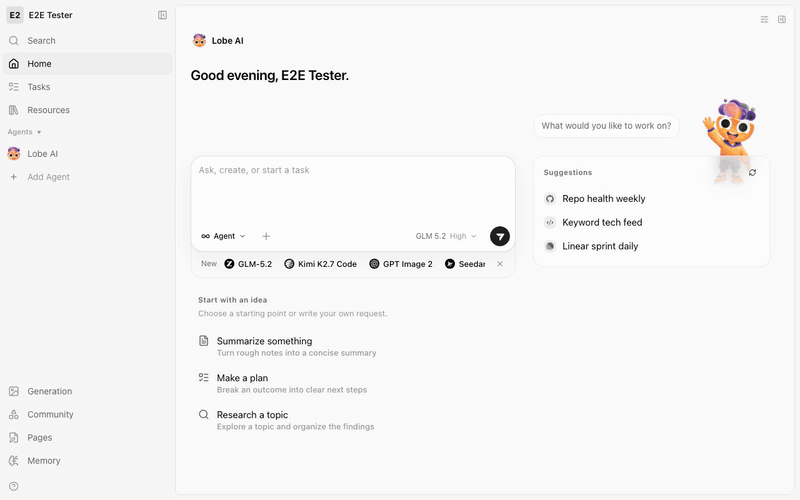

# LobeHub with NeevCloud Sandboxes

[LobeHub](https://github.com/lobehub/lobehub) is an open-source chat workspace you can host yourself.
Its built-in code execution runs in LobeHub's own sandbox, and a self-hosted install has none: ask
the agent to run a command and it answers `unauthorized`.

This example gives your LobeHub a real Linux machine instead. You add the NeevCloud Sandbox MCP
server as a connector, and the agent can create a sandbox, write files in it and run commands. It is
the stock LobeHub image with a compose override and one form filled in. No fork, no patch.

<p align="center">
  
</p>

## Run it

You need Docker, a **Sandboxes** key and a **Model API** key ([create a key](https://docs.ai.neevcloud.com/getting-started/create-api-key)).

First check that your Sandboxes key works. This script makes the calls LobeHub will make, then
deletes what it created. It uses only the Python standard library.

```bash
export NEEV_API_KEY=...
python3 check_connection.py
```

Then start LobeHub. Its installer is a bash script that writes a compose file and fresh secrets into
the folder you run it in:

```bash
mkdir lobehub && cd lobehub
bash <(curl -fsSL https://lobe.li/setup.sh) -l en
cp /path/to/examples/lobehub/docker-compose.override.yml .

export NEEV_MODEL_API_KEY=...
docker compose up -d --no-attach searxng
```

On Windows, see the [setup guide](../../docs/setup.md#windows) for the shell to use.

Open <http://localhost:3210>, sign up, and click through the short onboarding. Then add the
connector:

1. **Settings → Skills**, open the **Skill Store** (the second icon above the list), then
   **Add → Add Custom MCP Skill**.
2. Name it `neev-sandbox`, leave the type on **Streamable HTTP**, and enter the URL
   `https://mcp.sandboxes.as-south-1.ai.neevcloud.com/mcp`.
3. Set **Auth type** to **API Key** and paste your `NEEV_API_KEY`.
4. Click **Test connection**. It lists the 22 sandbox tools. Click **Install**.
5. On the home page, open the **+** menu in the composer, then **Skills**, search for `neev`, open
   the **…** menu on `neev-sandbox`, and choose **Pin**.

Ask the agent to use it:

> In the sandbox, write the exact text `hello-1234` into a file called proof.txt, then run python3 to
> print the sha256 hex digest of that file's contents, and tell me the digest.

Success is a reply that quotes the digest of the text you gave it. Check it yourself with
`printf %s hello-1234 | shasum -a 256`. The agent's steps show `Create_sandbox`, `fs_write` and
`Exec`. Output of `check_connection.py` from a real run:

```
  1. 22 tools published at https://mcp.sandboxes.as-south-1.ai.neevcloud.com/mcp
  2. sandbox lobehub-check-4181f202 created
  3. exec printed: hello from the sandbox
  sandbox lobehub-check-4181f202 deleted

The key works. Use the URL and key above in LobeHub.
```

And the agent, in LobeHub, after "Ran 6 steps (23s)":

```
File written: proof.txt containing exactly nonce-c600f3c056ec1cda (22 bytes, no trailing newline)
SHA-256 digest computed via python3:
444b5273b3390e2999e48a27cea56142e79767c0eb01592af9ba04157e9781f0
```

That digest is the real SHA-256 of that text, and the sandbox held the file.

## How it works

1. LobeHub's server opens a Streamable HTTP connection to the Sandbox MCP URL with your key as a
   bearer token. **Test connection** lists the tools over that connection.
2. The compose override points LobeHub's OpenAI provider at the NeevCloud model API and makes
   `glm-5-2` the default model, so the model that decides what to call is served by NeevCloud too.
3. Because the connector is pinned, the model has its tools from the first turn. A call made before
   any sandbox exists is refused with `no sandbox is bound to this connection: create one`, and the
   agent answers by calling `create_sandbox`.
4. `fs_write` and `exec` then run in that machine. State persists between calls, so a file written in
   one step is read in the next.

## Use it in your product

- Change the model in `docker-compose.override.yml`: `OPENAI_PROXY_URL` and `OPENAI_MODEL_LIST` name
  the endpoint and the models, and `DEFAULT_AGENT_CONFIG` picks the default.
- Run `check_connection.py` as a pre-flight whenever you rotate the key or change region: set
  `NEEV_SANDBOX_MCP_URL` to the regional URL (`DEFAULT_URL` in the script).

## Good to know

- **Pin the connector.** In **Auto** mode the model discovers tools itself, and in testing it chose
  LobeHub's built-in **Skills → Run Command**, which answers `unauthorized` on a self-hosted install.
- **Connections with the same key share one sandbox.** With no `x-sandbox-name` header it is named
  `default`; the MCP server uses the header as the name when the client sends one.
- **LobeHub's server makes the calls, not your browser.** The machine running LobeHub must reach the
  MCP URL.
- **LobeHub keeps the key with the connector.** Use a key for a project you are happy for everyone who
  can use that LobeHub to reach.
- **The connector speaks Streamable HTTP only.** The form says SSE is not supported.
- **The model picker lists more than this example configures.** `DEFAULT_AGENT_CONFIG` is what makes
  `GLM 5.2` the default for new chats.
- **No approval prompt appeared** for the pinned tools in this run.

## Time and cost

`check_connection.py` takes about four seconds. The agent run above took 23 seconds for six steps with
`glm-5-2`, including creating the sandbox. The first `docker compose up` also downloads LobeHub's
images, so it takes longer than later starts.

You pay for model tokens and for sandbox compute while it runs. An idle sandbox pauses itself and
stops billing compute, but it keeps its quota until it is deleted. `check_connection.py` deletes the
sandbox it creates in a `finally` block, so an interrupted run leaves nothing behind; a leftover
would be named `lobehub-check-` plus a random suffix. The sandbox LobeHub opens (`default`) is yours
to delete: ask the agent to call `delete_sandbox`, or delete it in the console.
