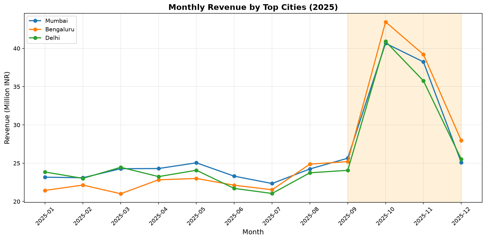

# AI data analyst

Ask a question about a CSV in plain English. An AI agent answers it by running pandas code in a NeevCloud Code Interpreter sandbox with no internet access, and gives you a chart and its findings. There is nothing to install, and the data stays loaded in the sandbox's Python kernel, so follow-up steps skip the reload and most run in a fraction of a second.

This is the TypeScript version of the [Python recipe](../ai-data-analyst-python): your code is TypeScript, and the analysis the agent writes runs as Python inside the sandbox.

<!-- run GIF: assets/runs/ai-data-analyst-js.gif, recorded on prod after v0.9.0 -->

<p align="center">
  
</p>

## Run it

You need Node 20.3+, a **Sandboxes** and a **Model API** key ([create a key](https://docs.ai.neevcloud.com/getting-started/create-api-key)), and your [organization and project IDs](https://docs.ai.neevcloud.com/getting-started/org-and-project#find-your-organization-id-and-project-id).

```bash
npm install
export NEEV_API_KEY=... NEEV_MODEL_API_KEY=... NEEV_ORG_ID=... NEEV_PROJECT_ID=...
npm start
```

On Windows, see the [setup guide](../../docs/setup.md#windows).

Output:

```text
1. Creating a Code Interpreter sandbox with no internet access...
   Ready in 13.3s. Uploading the data...
2. Asking glm-4-7: Which cities and product categories bring in the most revenue, and how much do October and November lift sales? Chart monthly revenue for the top cities.
   step 1: run_python (16 lines, ran in 4.4s)
   step 2: run_python (4 lines, ran in 0.2s)
   step 3: run_python (13 lines, ran in 0.2s)
   step 4: run_python (29 lines, ran in 0.2s)
   step 5: run_python (21 lines, ran in 0.2s)
   step 6: run_python (33 lines, ran in 2.1s)
   step 7: finish
   Analysis took 40.9s
3. Downloading chart.png...
   Saved chart.png (139 KB)
4. Findings:
• Top city is Mumbai with ₹319,470,485 in total revenue (16.4% share), followed by Bengaluru (₹314,820,949) and Delhi (₹311,445,046)
• Electronics leads categories with ₹860,777,623 (44.3% of all revenue), far ahead of Apparel (₹433,331,504) at 22.3%
• October drives a 79.6% revenue lift versus non-peak months, generating ₹260,492,818 vs baseline average of ₹145,004,588
• November follows with a 60.8% lift at ₹233,184,443, giving October+November a combined 70.2% average lift
• All four top cities (Mumbai, Bengaluru, Delhi, Hyderabad) show pronounced October-November spikes in monthly revenue
   Sandbox deleted.
```

Step 1 loads the CSV and imports pandas; the steps after it reuse the loaded data, which is why most take a fraction of a second.

With no arguments it analyses the bundled sample, `data/sales.csv`: a year of synthetic monthly sales for eight Indian cities. The chart is saved as `chart.png` and the findings are printed. To use your own data and question:

```bash
npm start -- --csv tickets.csv --out tickets.png "Which support channel is slowest to resolve?"
```

## How it works

1. **Sandbox.** The script starts a sandbox from the Code Interpreter template, `sb-ubuntu-26-04-interpreter`, with no internet access from the start. Python, numpy, pandas and matplotlib are already installed, so it only uploads your CSV.
2. **Analyse.** An agent connects to the sandbox over MCP. Its main tool, `run_python`, sends the code the model writes to the MCP server's `interpreter_run` tool, which runs it in the sandbox's Python kernel. Variables persist between calls, so the model loads the data once and builds each step on the results it already has. It keeps going until it has saved `chart.png` and written its findings.
3. **Download.** The script reads the chart back with `sandbox.files.read(...)`, checks it is a PNG, saves it and prints the findings.
4. **Clean up.** The sandbox, with your CSV in it, is deleted when the script ends, fails or you press `Ctrl+C`.

## Use it in your product

- **"Ask your data" in your app:** call `run()` in `analyst.ts` with the user's question and their uploaded file. It saves the chart to the path you give and prints the findings; send both back to your user.
- **Your own analyses:** change `SYSTEM_PROMPT` in `agent.ts`, for example to always produce a summary table or to follow your charting style.
- **Follow-up questions:** keep the sandbox running between questions instead of deleting it after one. Its kernel still holds the data and everything the agent computed, even over a new MCP session, so later questions skip the load.

## Good to know

- Code the model writes cannot open a network connection, so the only data that leaves the sandbox is what that code prints back to the model.
- The model never receives your file as such, only the question, the code it writes and what that code prints, which can include rows of your data.
- The sandbox runs in NeevCloud's `as-south-1` region in Indore, India, so your CSV is stored and processed there. The Model API does not let you choose the region a request is served from.
- The agent gets `run_python`, `fs_list` and `finish`. Any other tool, such as `delete_sandbox` or a bare `exec`, is refused.
- Each `run_python` call gets about 45 seconds. A longer one is interrupted and comes back with `end_reason` `deadline_exceeded`, and the model can split the work.
- A matplotlib figure left open at the end of a call comes back as an image. The recipe passes only text to the model, so the chart is saved with `plt.savefig('chart.png')` and downloaded with `sandbox.files.read(...)`.
- The kernel's working directory is `/workspace`, where `sandbox.files.uploadFile(...)` puts `data.csv`.
- The template has numpy, pandas and matplotlib but not, for example, scipy, scikit-learn or seaborn, and with no internet access the model cannot install them.
- The model is `glm-4-7` by default. Set `MODEL` to try another, for example `MODEL=glm-5-2`.

## Time and cost

Usually 35 to 60 seconds: the sandbox is ready in 5 to 15 seconds with nothing to install, then 5 to 9 agent steps. The first step, which loads the data, runs in 2.5 to 4.5 seconds; steps that build on it take 0.1 to 0.2 seconds, and drawing the chart 1 to 3 seconds. Most of the rest is the model writing code. Installing pandas and matplotlib on the default template instead adds about 30 seconds before the first step. The agent is limited to 20 steps and 4 minutes. You pay for the sandbox while it runs and for the model tokens. If the process is killed outright, delete any leftover `data-analyst-js-` sandbox from the console.
