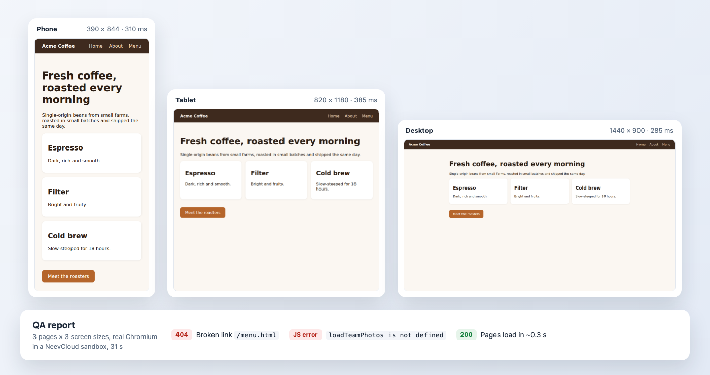

# Browser QA agent

Run a real browser QA pass in one command. A sandbox with Playwright and Chromium already installed checks a site on a phone, a tablet and a desktop screen: HTTP status, load time, console errors and broken links. You get a full-page screenshot per screen size and a short report on your machine, and nothing runs in your own browser.

This is the TypeScript version of the [Python recipe](../browser-qa-agent-python).

<!-- run GIF: assets/runs/browser-qa-agent-js.gif, recorded on prod after v0.9.0 -->

<p align="center">
  
</p>

## Run it

You need Node 20.3+, a **Sandboxes** key ([create a key](https://docs.ai.neevcloud.com/getting-started/create-api-key)), and your [organization and project IDs](https://docs.ai.neevcloud.com/getting-started/org-and-project#find-your-organization-id-and-project-id).

```bash
npm install
export NEEV_API_KEY=... NEEV_ORG_ID=... NEEV_PROJECT_ID=...
npm start
```

On Windows, see the [setup guide](../../docs/setup.md#windows).

With no arguments it checks a small demo site that ships with the recipe and has two bugs planted in it: a broken link and a script error. To check your own site, pass `--url`:

```bash
npm start -- --url https://example.com
```

Output:

```text
1. Creating a sandbox from sb-ubuntu-26-04-playwright (no internet access)...
2. Uploading the QA script...
   Serving the bundled demo site on http://127.0.0.1:8080/
3. Checking http://127.0.0.1:8080/ on phone, tablet and desktop...
   phone   200       310 ms  console errors: 0  http://127.0.0.1:8080/
   phone   200       399 ms  console errors: 1  http://127.0.0.1:8080/about.html
   phone   404       190 ms  console errors: 1  http://127.0.0.1:8080/menu.html
   tablet  200       302 ms  console errors: 0  http://127.0.0.1:8080/
   tablet  200       198 ms  console errors: 1  http://127.0.0.1:8080/about.html
   tablet  404       195 ms  console errors: 1  http://127.0.0.1:8080/menu.html
   desktop 200       308 ms  console errors: 0  http://127.0.0.1:8080/
   desktop 200       398 ms  console errors: 1  http://127.0.0.1:8080/about.html
   desktop 404       280 ms  console errors: 1  http://127.0.0.1:8080/menu.html
   links: checking 3, not checking 0...
   done
4. Downloading the screenshots and report to qa-report/...
5. Summary:
   Page            Status        Phone    Tablet   Desktop  Console errors
   /               200          310 ms    302 ms    308 ms  0
   /about.html     200          399 ms    198 ms    398 ms  1  loadTeamPhotos is not defined
   /menu.html      404          190 ms    195 ms    280 ms  1  Failed to load resource: the server responded with a stat...
   Broken links: 1 of 3 checked, 0 not checked
     http://127.0.0.1:8080/menu.html (404)
   Done in 27 s. Open qa-report/report.md and the screenshots.
   Sandbox deleted.
```

`qa-report/` then holds `phone.png`, `tablet.png`, `desktop.png`, `report.md` and `report.json`. Change the folder with `--out`.

## How it works

1. **Sandbox.** The script creates a sandbox from the `sb-ubuntu-26-04-playwright` template, which has Node, Playwright and Chromium preinstalled, so there is no install step. For the demo site it has no internet access; with `--url` it can reach only that site's host and any `--allow` hosts.
2. **Upload.** It writes [`sandbox/qa.js`](sandbox/qa.js) into the sandbox. For the demo, it also writes the site in [`sandbox/site/`](sandbox/site) and serves it on `127.0.0.1:8080` with `sandbox.processes.start(...)`.
3. **QA pass.** `sandbox.exec(["node", "qa.js", url], { stream: true })` runs the check and streams one line per page as it goes. For each screen size, `qa.js` opens the start page and up to four pages it links to on the same site, records the status, load time and console errors, and takes a full-page screenshot of the start page. Then it checks up to 25 links it found. It stops visiting pages after 7 minutes, so a slow site still gets a report.
4. **Download.** `sandbox.files.downloadFile(...)` copies the screenshots and both reports to your machine, and the script prints the summary.
5. **Clean up.** The sandbox is deleted when the run ends, fails or you press `Ctrl+C`.

## Use it in your product

- **QA on every deploy:** run it against your preview or staging URL in CI and fail the job when `report.json` lists broken links or console errors.
- **Your own checks:** `qa.js` is plain Playwright, so add what your team cares about, such as an accessibility scan, a login flow or a check that a button is visible on phone.
- **Your own screen sizes:** edit `VIEWPORTS` at the top of `qa.js`.
- **Untrusted sites:** the browser runs in the sandbox, not on your machine or your CI runner, and it can reach only the hosts you allow.

## Good to know

- With `--url`, the sandbox can reach only that site's host. A page that loads scripts, fonts or images from other hosts stalls for about 30 seconds per page and screen size, and the report shows `net::ERR_NAME_NOT_RESOLVED` and `did not finish loading in 30 s`. Allow each host it needs with `--allow HOST` (repeat it), or create the sandbox with internet access instead ([Internet access](https://docs.ai.neevcloud.com/agentic-studio/overview/internet-access)).
- Links are checked only on hosts the sandbox may reach; the rest are counted as "not checked". A link that redirects to a host you have not allowed shows as unreachable. For example, the `iana.org` link on example.com needs `--allow iana.org --allow www.iana.org`.
- The template's Playwright is the `@playwright/test` package, found through `NODE_PATH`. Load it with `require("@playwright/test")`; `require("playwright")` fails because that package is not installed.
- Runs are headless. The template has a VNC server for watching a headed run, but it listens only inside the sandbox, so reach it through SSH: open a tunnel with `sandbox.ssh()`, then forward the VNC port with `ssh -p <tunnel port> -L 5901:127.0.0.1:5901 root@127.0.0.1` and point a VNC viewer at `127.0.0.1:5901` ([SSH](https://docs.ai.neevcloud.com/agentic-studio/overview/ssh)).
- The demo server listens on `127.0.0.1`, so nothing outside the sandbox can reach it.

## Time and cost

About 30 seconds for the demo site, most of it creating the sandbox; the checks themselves take a few seconds. A public site takes longer: example.com took about 25 seconds, and a site whose asset hosts were not allowed took almost 7 minutes, because each of its 15 page visits waited 30 seconds. You pay for the sandbox while it runs, and there is no model cost. If the process is killed outright, delete any leftover `browser-qa-` sandbox from the console.
