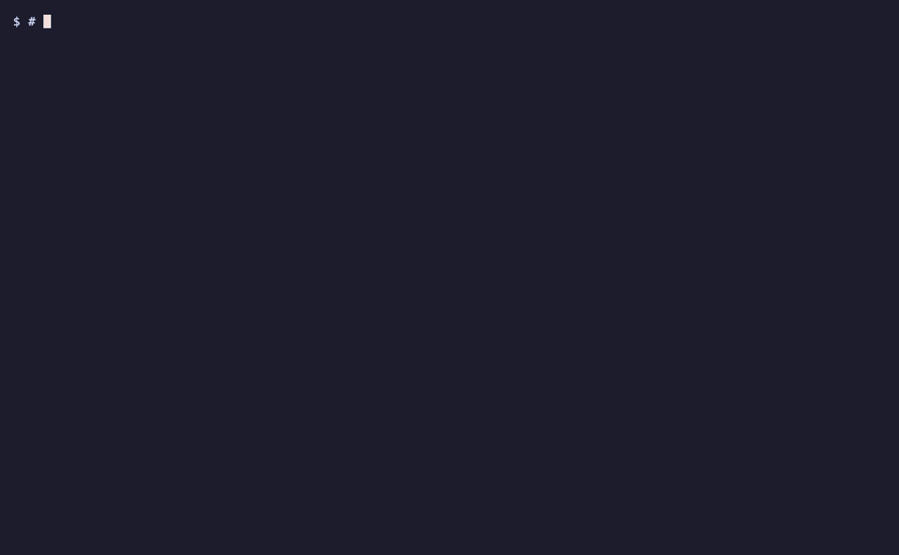

# Run your tests in a sandbox with crabbox

Your tests pass on your Mac, you push, and ten minutes later CI fails on Linux. [crabbox](https://github.com/openclaw/crabbox) closes that gap: one command copies your checkout, uncommitted changes included, to a fresh NeevCloud Linux sandbox, runs your tests there, streams the output and hands back the exit code, then deletes the sandbox. You see the Linux result in about 20 seconds, before you push. There is no adapter to write: one config file tells crabbox to drive `neev-cli`.

<p align="center">
  
</p>

## Why run tests this way

- **Catch Linux-only failures before CI does.** File names are case-sensitive on Linux and not on a Mac, paths and line endings differ, and some packages only build on one of them. The demo below is a real example: green on a Mac, red on Linux.
- **A clean machine every run.** No stale virtualenv, cache or leftover file from last week makes a test pass that would fail for everyone else.
- **Keep your laptop out of it.** A slow or heavy suite, or one that writes files and starts processes, runs in a throwaway sandbox while you keep working.
- **Let a coding agent test safely.** Claude Code, Codex or any agent can run `crabbox run -- <tests>` and read the result, without running anything on your machine.

## Why not just Docker?

Docker on your Mac gives you Linux, and for many projects that is enough. But the usual way of running tests in it, mounting your folder with `docker run -v`, misses the bug in this recipe's demo:

| How the demo's tests ran | Machine | Result |
| --- | --- | --- |
| On a Mac | macOS, arm64 | passes |
| Docker Desktop, folder mounted with `-v` | Linux, arm64 | passes |
| Docker, files copied into the container | Linux, arm64 | fails |
| crabbox, NeevCloud sandbox | Linux, x86_64 | fails |

A mounted folder keeps the Mac's case-insensitive file names inside the container, and Docker on Apple silicon runs arm64 while most CI runs x86_64. crabbox also helps where Docker on your laptop doesn't:

- **Coding agents.** An agent allowed to run `docker` on your machine can do anything on it. With `crabbox run` its commands run on a throwaway machine elsewhere.
- **Nothing to keep in step.** No Dockerfile to match CI; you run the test command you already use.
- **Your laptop stays free.** Long or heavy suites run in the sandbox, and you can run several at once in separate sandboxes.

If your tests are small, already run in a container that matches CI, and don't depend on file-name case or CPU architecture, Docker is a fine choice.

## Run it

You need [crabbox](https://github.com/openclaw/crabbox#install) with the local tools its install guide lists (OpenSSH, `git`, `rsync`), [neev-cli](https://github.com/NeevCloudAI/neev-cli) 0.9 or later, Python 3, a **Sandboxes** key ([create a key](https://docs.ai.neevcloud.com/getting-started/create-api-key)), and your [organization and project IDs](https://docs.ai.neevcloud.com/getting-started/org-and-project#find-your-organization-id-and-project-id). Use a project for this alone, so crabbox's sandboxes stay apart from everything else.

**1. Save the key on a neev-cli context.** crabbox strips environment variables from the SSH connections it opens, so `NEEV_API_KEY` in your shell never reaches the `neev-cli` that carries SSH to the sandbox. Save the key once instead; the org and project come from the context too, so the config needs no IDs:

```bash
echo "$NEEV_API_KEY" | neev-cli context set crabbox --org <org-id> --project <project-id> --sandbox-api-key
neev-cli context use crabbox
```

**2. Install the crabbox config.** crabbox accepts SSH settings only from your user config, never from a file in a repository, and only when the file is private to you. From this folder:

```bash
mkdir -p "$(dirname "$(crabbox config path)")"
test ! -e "$(crabbox config path)" && install -m 600 crabbox.yaml.example "$(crabbox config path)"
crabbox doctor
```

`crabbox config path` prints `~/Library/Application Support/crabbox/config.yaml` on macOS and `~/.config/crabbox/config.yaml` on Linux. The `test` stops the copy if you already have a config there; then copy the example to another file outside any repository, `chmod 600` it, and point `CRABBOX_CONFIG` at it. `crabbox doctor` ends with `declarative external provider ready` when neev-cli can reach your project.

**3. Run the demo.** `demo/` is a tiny shop module that reads tax rates from `rates.json`, with three standard-library tests. crabbox syncs a git checkout, so copy it into one of its own and run the tests on your machine first:

```bash
cp -R demo ~/crabbox-demo && cd ~/crabbox-demo
git init -q && git add . && git commit -qm "demo"
python3 -m unittest
```

On a Mac they pass. Now run the same command on Linux:

```bash
crabbox run -- python3 -m unittest
```

Every test fails in the sandbox and `crabbox run` exits 1, as CI would after you push:

```text
ERROR: test_standard_rate (test_pricing.TotalTest.test_standard_rate)
...
FileNotFoundError: [Errno 2] No such file or directory: '/workspace/crabbox/cbx_824ff6027941/crabbox-demo/Rates.json'

----------------------------------------------------------------------
Ran 3 tests in 0.006s

FAILED (errors=3)
remote command exited 1
```

The code opens `Rates.json`, but the file is `rates.json`. A Mac's disk ignores the difference; Linux does not. Fix it without committing, and run again:

```bash
git apply fix.patch
crabbox run -- python3 -m unittest
```

The uncommitted fix goes up with the rest, the tests pass in a new sandbox, `crabbox run` exits 0, and the sandbox is deleted:

```text
sync candidate: 5 files, 1.1 KiB dirty_delta=1 files, 468 B
...
Ran 3 tests in 0.002s

OK
...
sandbox "cbx-bdf70c9f0039" deleted
```

## How it works

1. **Create.** `crabbox run` calls `neev-cli sandbox create` with a name made from the lease, `cbx-` plus 12 hex characters, and waits until the sandbox is ready.
2. **Connect.** Every SSH connection goes through `neev-cli sandbox ssh-proxy`, which authenticates with the key on your context.
3. **Sync.** crabbox copies your tracked and untracked, non-ignored files, with your uncommitted edits, to `/workspace/crabbox` in the sandbox.
4. **Run.** It runs your command there, streams its output and exits with its exit code.
5. **Delete.** It calls `neev-cli sandbox delete`, whether the command passed or failed.

## Use it in your project

- **Your own test command:** run `crabbox run -- <command>` from the top of your repository, for example `crabbox run -- make test`. No change to the config.
- **Your dependencies:** the `acquire` step in `crabbox.yaml.example` creates a 2 CPU, 4 GB sandbox from `sb-ubuntu-26-04-dev`. Point `--template-id` at a template with your toolchain installed, so each run starts ready.
- **Package installs:** a sandbox has no internet access by default. Add `--allow <host>` to the `acquire` step for each host your tests need, such as your package index ([Internet access](https://docs.ai.neevcloud.com/agentic-studio/overview/internet-access)).
- **From a coding agent:** tell Claude Code, Codex or another coding agent to test with `crabbox run -- <command>`. Its test runs then happen in a throwaway sandbox instead of on your machine, and it still sees the output and exit code.
- **A warm box for a tight loop:** `crabbox run --keep -- <command>` leaves the sandbox up and prints its lease. `crabbox run --id <lease> -- <command>` reuses it and syncs only what changed. `crabbox list` shows kept boxes and `crabbox stop --id <lease>` deletes one.

## Good to know

- A fresh sandbox per run is the default and the recommended mode: nothing from an earlier run can leak into the next.
- `sync.gitSeed: false` is required. The sandbox can't reach your git remote, so crabbox ships the files from your checkout instead of cloning.
- `sshConfigProxy: true` is required alongside `proxyCommand`, so that crabbox's readiness check also goes through the proxy.
- `crabbox list` sees only sandboxes whose names start with `cbx-`, the `namePrefix` in the config.
- On a failed run crabbox saves a small failure bundle under `.crabbox/` in your checkout. The demo's `.gitignore` keeps it out of git; add the same line to yours.
- macOS and Linux only for now. crabbox runs on Windows, but we have not verified this setup there.

## Time and cost

The example config asks for 2 CPUs and 4 GB. crabbox runs many short commands to sync, and on the demo 2 CPUs brought a fresh run from about 20 seconds to about 15: about 3.5 seconds to create the sandbox, 6 to sync and under 2 to run the tests, then the delete. A run costs about 50% more CPU time than with 1 CPU; drop `--cpu` and `--memory-gb` from the `acquire` step to use the defaults. A kept box reused with `--id` spends most of its time in sync too, because crabbox runs each of its sync steps as a separate remote command. You pay only for sandbox time while it exists; there are no model tokens. crabbox deletes the sandbox at the end of every run, passing or failing. If it is killed before it can, `crabbox list` shows the leftover and `crabbox stop --id <lease>` deletes it, or delete any `cbx-` sandbox from the console.
